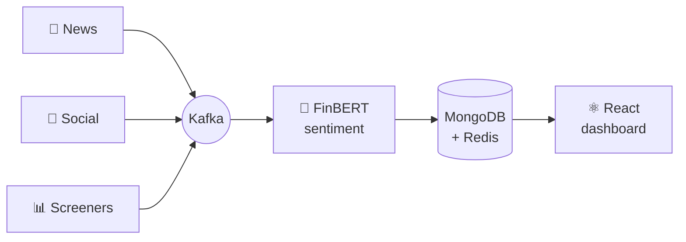

  

<!-- TODO: add your LinkedIn / email / portfolio links here, e.g.

  
  

-->

### 👋 About me

- 🔬 I care about **rigor**: reproducible pipelines, leakage tests, confidence intervals, and saying so when a fancy model *doesn't* beat the baseline.
- 🤖 Working across **ML forecasting**, **LLM evaluation**, **on-device AI**, and **full-stack web**.
- 🌱 Currently building **Rigor**, a self-hostable eval platform that fails a PR when a prompt change causes a statistically significant regression.

---

### 🚀 Featured projects

### ⚡ [FlashFeed](https://github.com/Amansome/FLASHFEED-DASHBOARD): real-time market intelligence platform
*Team capstone · a Bloomberg-style terminal for retail investors*

FlashFeed pulls in financial news, social media chatter, screener data and live prices from **30+ sources**, scores sentiment with **FinBERT**, and streams everything through **Kafka** into an 8-page React dashboard covering **8,000+ US stocks**.

  
  
  
  
  

<table>
<tr>
<td width="50%" valign="top">

**What the platform does**
- Candlestick charts with Bollinger Bands, RSI and MACD, with social-media volume and sentiment overlaid on price
- 1-minute bars resampled in the browser to 5m–1h, so timeframe changes are instant
- Momentum "trade watch" scoring that combines price, social volume and news sentiment
- News-to-price correlation analysis
- Two sentiment paths: rule-based (500 articles in under 30 s) and FinBERT for accuracy

</td>
<td width="50%" valign="top">

**What I built**
- 📈 **Sentiment charting system** (`/sentcharts`) for plotting sentiment against price
- 🎯 **Entry Screener, Exit Screener and Window Mirror** pages
- 🔄 Migrated candlestick charts to **lightweight-charts v5**
- 🔐 **Self-healing Finviz Elite auth** for the chart service
- 🚀 **Production deployment**: frontend and backend served from one Railway origin, a Vercel API proxy, Docker base switched from Alpine to Debian-slim for standalone builds, and a CI workflow that syncs from upstream

</td>
</tr>
</table>

`React` `TypeScript` `Vite` `Express` `Hono` `Python` `FinBERT` `Kafka` `MongoDB` `Redis` `Docker` `Railway` `Vercel`

 

<table>
<tr>
<td width="50%" valign="top">

#### 📈 [ForecastLab](https://github.com/Amansome/forecastlab)
Reproducible quarterly-revenue forecasting for 10 US public companies from SEC EDGAR data. Naive, seasonal-naive, ETS and a global **LightGBM** model under a 12-origin rolling backtest.

- **33% lower MASE** than seasonal naive (0.787 vs 1.171)
- Bootstrap CIs, SHAP, **7 leakage tests**, byte-identical reruns
- Optional **PySpark** re-implementation with parity check

`Python` `LightGBM` `statsmodels` `PySpark` `SHAP`

</td>
<td width="50%" valign="top">

#### 🧪 [Rigor](https://github.com/Amansome/rigor)
LLM evaluation treated like software tests: evals in YAML, run on every PR, **build fails on statistically significant regressions**.

- Benchmarked Llama 3.2, Gemma 4, Qwen 3.5 on HumanEval
- Root-caused a 30-pt Qwen gap to a prompt-format quirk, not capability
- Local-first via Ollama + LiteLLM

`Python` `FastAPI` `Postgres` `LiteLLM` `Next.js`

</td>
</tr>
<tr>
<td width="50%" valign="top">

#### 🍳 [KAI: Kitchen Assistant](https://github.com/Amansome/KAI)
Voice-activated iPad app for restaurant staff. Say *"Hey, Kai"*, ask about a recipe, and hear the answer without touching the screen.

- **On-device Llama 3.2 1B**: fully offline, no data leaves the iPad
- Wake word (~200 ms), speech recognition and TTS
- Python pipeline turning recipe PDFs into structured JSON

`Swift` `SwiftUI` `LLM.swift` `Python`

</td>
<td width="50%" valign="top">

#### ♟️ [Opening Gym](https://github.com/Amansome/opening-gym)
Free, open-source, **local-first chess opening trainer** with spaced repetition. No account, no backend, no tracking.

- 24 courses, 5 training modes, **FSRS** spaced repetition
- In-browser **Stockfish** analysis and a game checker
- Offline PWA, mobile-first, keyboard and screen-reader friendly

`TypeScript` `IndexedDB` `Service Worker` `Stockfish`

</td>
</tr>
</table>

---

### 🛠️ Tech stack

  

  <b>ML / Data:</b> LightGBM · scikit-learn · statsmodels · pandas · PySpark · SHAP · Jupyter 
  <b>LLMs:</b> Claude API · Ollama · LiteLLM · llama.cpp / LLM.swift

